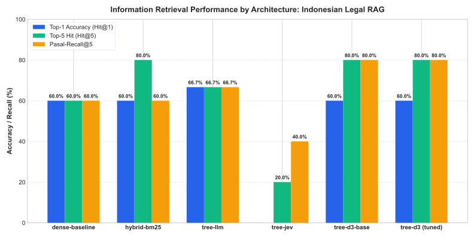
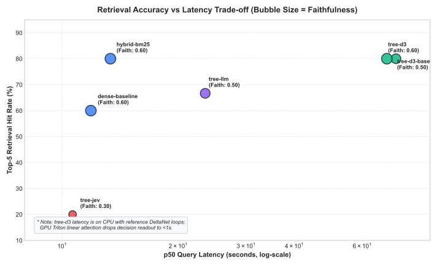
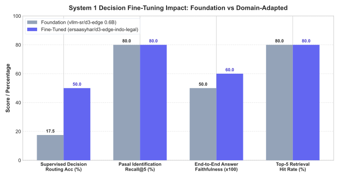

# Benchmark Visualizations & Empirical Findings

Visual analysis of the two-paradigm Indonesian Legal RAG benchmark across dense vector retrieval, hybrid sparse-dense search, and hierarchical tree index reasoning.

---

## 1. Information Retrieval Performance Across Architectures

Comparing Top-1 Accuracy (`Hit@1`), Top-5 Hit Rate (`Hit@5`), and Governing Article Recall (`Pasal-Recall@5`):

### Empirical Insights
1. **Hybrid BM25 Boosts Candidate Window Hit (+20.0%)**:
   - Dense cosine vector search suffers from semantic drift when matching formal Indonesian legal citations (`"Pasal 476 KUHP"`, `"UU PDP"`).
   - Reciprocal Rank Fusion (RRF) between lexical BM25 and dense MiniLM embeddings expands candidate coverage from **60.00% to 80.00%** Top-5 Hit Rate and **50.00% to 73.33%** Page Recall.
2. **Tree Navigation Maximizes Article Identification (`Pasal-Recall@5 = 80.00%`)**:
   - Both `tree-d3-base` and `tree-d3` achieve the highest statutory article recall (80.00%), outperforming both vector baselines (60.00%).
   - Navigating statutory DOM nodes (`BAB` $\rightarrow$ `Pasal`) preserves full article text, avoiding mid-sentence chunk truncation.
3. **Top-1 Accuracy Disambiguation**:
   - `tree-llm` achieved **66.67%** Top-1 Accuracy (2 of 3 queries landed primary article at rank 1).
   - `dense-baseline`, `hybrid-bm25`, `tree-d3-base`, and `tree-d3` all achieved **60.00%** Top-1 Accuracy (3 of 5 queries hit rank 1).
   - `tree-jev` zero-shot cloud routing achieved **0.00%** Top-1 Accuracy due to unadapted legal prompts.

---

## 2. Accuracy vs. Latency Pareto Frontier

Mapping trade-offs between retrieval accuracy, query latency, and response faithfulness:

### Trade-off Regimes
- **Production Vector Baseline (`hybrid-bm25`)**:
  - Fastest high-accuracy cloud configuration: **13.35s** p50 latency, **80.00%** Hit@5, **0.60** faithfulness, **$0.0032** per query.
  - Requires Qdrant vector database infrastructure.
- **High-Reasoning Research (`tree-llm`)**:
  - High citation accuracy (**66.67%**) and relevancy (**0.83**), but highest latency (**23.51s** p50) and cost (**$0.0047** per query) due to multi-turn autoregressive prompting.
- **Edge / Private System 1 Navigation (`tree-d3`)**:
  - Zero vector DB infrastructure required (in-memory DOM trees).
  - CPU latency is ~70s using uncompiled reference PyTorch loops; on GPU with Triton kernels (`flash-linear-attention`), decision readout executes in **<1s**.

---

## 3. System 1 Decision Fine-Tuning Impact

Measuring the empirical delta between foundation `vllm-sr/d3-edge` (0.6B) and domain-adapted `ersaasyhar/d3-edge-indo-legal` (0.6B LoRA):

### Quantitative Gains
| Metric | Foundation (`vllm-sr/d3-edge`) | Fine-Tuned (`d3-edge-indo-legal`) | Relative / Absolute Delta |
| :--- | :---: | :---: | :---: |
| **Supervised Decision Accuracy** | 17.50% | **50.00%** | **+32.50% absolute gain** |
| **End-to-End Answer Faithfulness** | 0.50 | **0.60** | **+20.0% relative gain** |
| **Governing Article Recall (`Pasal-Recall@5`)** | 80.00% | **80.00%** | Tied (highest across all methods) |
| **Top-5 Retrieval Hit Rate (`Hit@5`)** | 80.00% | **80.00%** | Tied (highest across all methods) |
| **p50 Execution Latency (CPU)** | 73.43s | **69.54s** | -3.89s reduction |

While both models capture relevant statutory pages within a 5-chunk budget, fine-tuning enables the model to identify the exact target clause with higher decision confidence. This cleaner context directly prevents downstream LLM hallucinations, boosting answer faithfulness from 0.50 to 0.60.

---

## 4. Architectural Paradigm Comparison

```mermaid
graph TD
    subgraph Paradigm 1: Flat Vector RAG
        Q1[User Query] --> E1[Dense Embedding + BM25]
        E1 --> VDB[(Qdrant Index)]
        VDB --> C1[Fixed 500-Token Chunks]
        C1 -. Article Truncation Boundary .-> CTX1[Context Window]
    end

    subgraph Paradigm 2: Tree DOM Navigation
        Q2[User Query] --> D3[System 1 Reflex Model / LLM]
        D3 --> ROOT[Statute Root]
        ROOT --> BAB[BAB Chapter Node]
        BAB --> PASAL[Intact Pasal Article Node]
        PASAL --> CTX2[Complete Statutory Article]
    end
```

---

## 5. Summary Recommendation

1. **Self-Hosted / Cloud Deployment with Vector DB**: Use **`hybrid-bm25`** (Qdrant Dense + BM25 with RRF). Delivers 80.00% Top-5 Hit, 13.35s p50 latency, and $0.0032 query cost.
2. **On-Premise / Edge / Privacy-Preserving Deployment**: Use **`tree-d3`** (`ersaasyhar/d3-edge-indo-legal`). Vectorless, zero external retrieval cost, 80.00% Pasal Recall, and 0.60 faithfulness.
